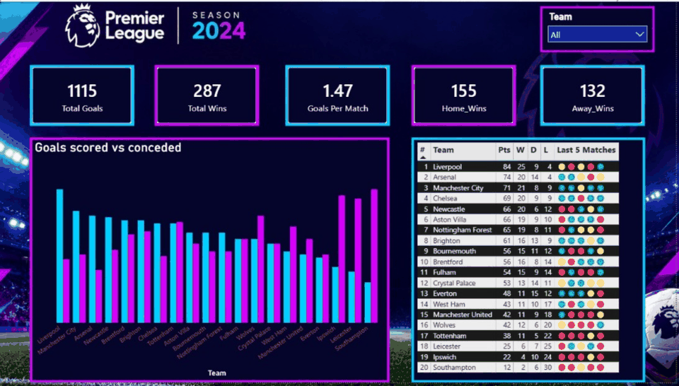

# EPL ETL Pipeline and Analytics

End-to-end pipeline that loads English Premier League data from a REST API into a SQL Server warehouse and a Power BI dashboard, with repeatable loads and built-in audit checks.

  

## What it does

- Extracts data from the **API-Football REST API** with Python and Requests
- Transforms and validates it with Pandas
- Loads it into a **SQL Server staging layer**, then a **dimensional warehouse** with fact and dimension tables
- **Upserts** fixtures and refreshes standings, so reruns update existing records and never create duplicates
- Exposes **SQL analytical views** that feed a **Power BI dashboard**

## Data

| Entity | Records |
|---|---|
| Teams | 20 |
| Fixtures | 380 |
| Standings | 20 |
| **Total** | **420** |

Source: API-Football REST API (English Premier League).

## Architecture

```
API-Football REST API
        |
 Python (Requests, Pandas): extract, transform, validate
        |
 SQL Server: staging layer
        |
 SQL Server: dimensional warehouse (fact + dimension tables)
        |
 SQL analytical views
        |
 Power BI dashboard
```



## Data quality checks

Three warehouse audit checks run after each load. All three returned **zero issues**:

1. Duplicate fixtures
2. Missing fixture-team references
3. Invalid standings

## Dashboard

The Power BI dashboard tracks team performance, match outcomes and league standings, including **1,115 goals** across the dataset.

## Tech stack

Python, Pandas, Requests, SQL Server (T-SQL), Power BI.

## Author

**Romy Avril Augustine**, Data Analyst, Kochi, India. 9 years of professional experience (since 2017) across finance operations and, now, analytics.
[LinkedIn](https://www.linkedin.com/in/romyavril/) | [Portfolio](https://romyavril96.github.io/Romy_Portfolio/) | avrilaugustine1996@gmail.com
